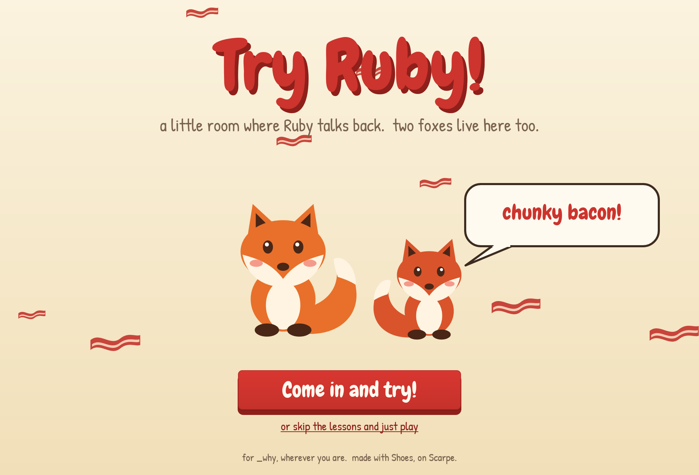
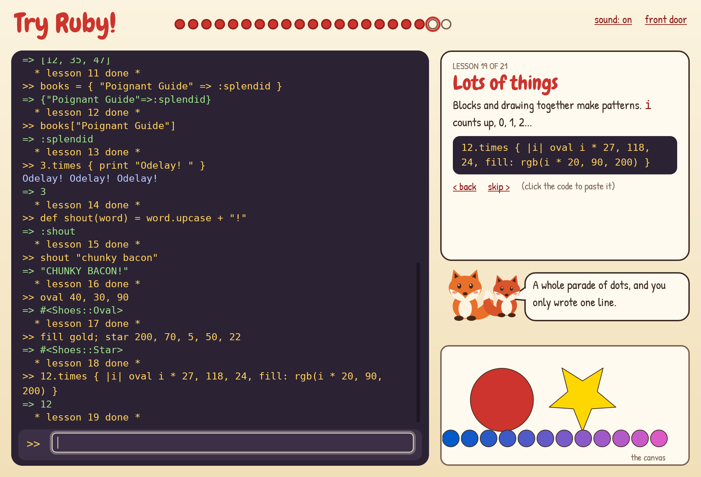
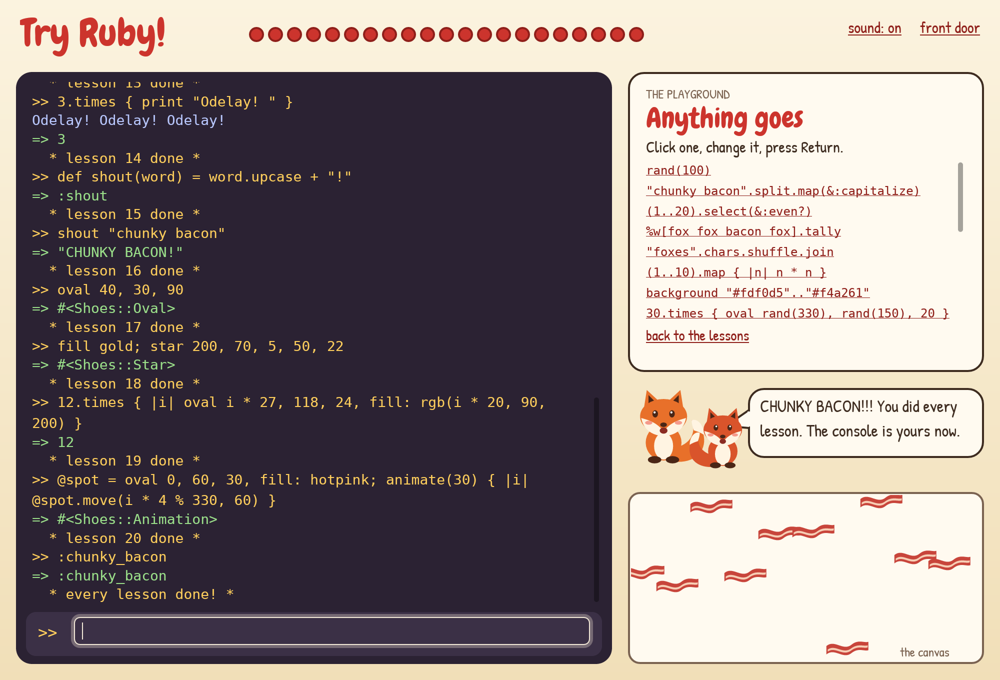

# Try Ruby!

*A little room where Ruby talks back. Two foxes live here too.*

A desktop Try Ruby, written in [Shoes](https://github.com/scarpe-team/scarpe/blob/main/docs/static/manual.md)
and run by [Scarpe](https://github.com/scarpe-team/scarpe)'s native display. You type Ruby into
a console and Ruby answers. Twenty-one small lessons walk you from `2 + 6` to teaching Ruby
your own words, and then to drawing and animating on a Shoes canvas. At the end there is a
secret word.

For _why, who made Try Ruby, Shoes, Hackety Hack and the foxes, and who taught a lot of us that
a programming language can be a playground. Wherever you are: chunky bacon.







## What's in the room

- **A real Ruby console.** Variables and methods stay put between lines. A `def` (or an open
  bracket, or a string) can run over several lines: the prompt turns to `..` and waits for the
  `end`. What you `puts`, `print` or `p` shows up, then the value after `=>`. Mistakes come out
  in red, in one readable line.
- **Twenty-one lessons**, each with a code chip you can click to paste. The foxes cheer each one,
  the dots along the top fill in, and lesson two learns your name so the later lessons use it.
- **A Shoes canvas.** `oval`, `star`, `rect`, `fill`, `background`, `para`, `animate`, `every`...
  anything Shoes draws goes on the canvas in the corner, never on the app around it.
- **Two foxes** who blink, hop, and shout when shouting is called for.
- **A playground** once the lessons are done (or skipped): a scroll of things to try.
- **It remembers.** Your name, how far you got and the mute switch are kept in Application
  Support (`~/.local/share/try_ruby` on Linux), so "Carry on" picks up where you left off.
- **It's hard to break.** An endless loop is stopped after 3 seconds. `exit` and `visit` are off
  limits. A timer that raises stops itself and says so. `reset` forgets everything.

In the console: **Return** runs a line, **Escape** drops it, **Ctrl-P / Ctrl-N** walk back and
forth through what you typed, **Ctrl-L** clears the log. The console also knows a few words of
its own: `help`, `next`, `back`, `lessons`, `play`, `clear` (log and canvas), `reset`, `mute`.
And `why`.

## Run it

You need a clone of Scarpe (the `native-rust` branch, until it lands on `main`), Ruby 3.2.11 or
newer, and Rust; Scarpe's [FOR_AGENTS.md](https://github.com/scarpe-team/scarpe/blob/main/FOR_AGENTS.md)
has the setup. Then:

```sh
cd ~/scarpe && bundle exec ruby exe/scarpe --native ~/scarpe-try/try_ruby.rb
```

## Make it a Mac app

Packaging runs on macOS, from the Scarpe clone:

```sh
cd ~/scarpe
bundle exec ruby exe/scarpe package ~/scarpe-try/try_ruby.rb --native --dmg \
  --name "Try Ruby" --icon ~/scarpe-try/icon/icon.png --output ~/scarpe-try/dist
```

That writes `dist/Try Ruby.app` and `dist/Try Ruby.dmg`. The `fonts` folder travels inside
automatically. The app is ad-hoc signed, not notarised, so the first time you open a copy that
was downloaded, macOS blocks it: open it once, then choose **Open Anyway** in System Settings,
Privacy & Security (or `xattr -dr com.apple.quarantine "/Applications/Try Ruby.app"`).

## Checks

```sh
./checks/run            # all of them
./checks/run lessons    # the ones whose names match
```

`checks/*.sspec` are Scarpe checks, run headless with the bundled fonts:

- `front_door` draws the page, lets the foxes talk, and goes in and back out.
- `lessons` walks all 21 lessons with each lesson's own example, and checks the name is
  learned, wrong answers don't pass, progress is saved and the finale tidies up after itself.
- `console` covers multi-line input, Escape, output, every kind of error, the 3-second limit,
  `exit`, `reset`, the canvas and its timers, history, the console's own words and the chimes.

`checks/run` fills in where the app is (each check runs in a sandbox with its own `HOME`) and
calls Scarpe's `spec/run --display native`. Set `SCARPE` if your clone is not `~/scarpe`.

`./scarpe.sh` runs Scarpe from your clone with a scratch `HOME` and with sounds, dialogs and the
clipboard trapped, for looking at the app without a window:

```sh
./scarpe.sh peek try_ruby.rb --click "Come in and try" --wait 0.3 --type "2 + 6" --key enter \
  --scale 2 --shot shots/peek.png
```

## What's where

| | |
|---|---|
| `try_ruby.rb` | the whole app |
| `fonts/` | Chewy (Apache 2.0) for headings, Patrick Hand (SIL OFL 1.1) for the prose; licences beside them |
| `icon/icon.rb` | the icon, drawn by Scarpe; `icon/icon.png` is it with the corners cut |
| `checks/` | the checks and `checks/run` |
| `shots/` | the pictures above |
| `scarpe.sh` | runs Scarpe from your clone, sandboxed |
